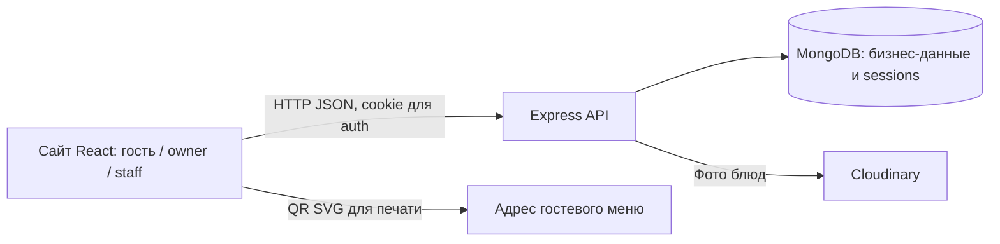

# MenuGo — архитектура и аудит кода

Состояние на этапе 12.0. Описание «есть» относится к файлам репозитория, а не к подтверждённой работе на production. База и внешние провайдеры при этом аудите не вызывались. Целевые правила находятся в [спецификации](product-spec.md), проверки — в [критериях приёмки](acceptance.md).

## Состав и версии

- `client/`: React, React DOM, TypeScript, Vite, локальный Manrope; отдельные страницы `/`, `/login`, `/dashboard`, `/menu/:cafeSlug/:tableCode`. React router как отдельная библиотека не установлен; переходы реализованы в `client/src/Router.tsx` через History API.
- `server/`: Node.js 24, Express 5, Mongoose, MongoDB; `app.ts` монтирует публичные, auth и manage маршруты. `index.ts` слушает `127.0.0.1`, запускает подключение к БД, при завершении закрывает HTTP, session manager и Mongoose.
- Фото блюд: Cloudinary Node SDK только на сервере, `multer` в памяти, проверка MIME и сигнатуры через `file-type`. QR: клиентская библиотека `qrcode` создаёт печатный SVG.
- По `package-lock.json` фактически установленные версии **совпадают** с предоставленным списком: React/DOM `19.3.1`, Vite `6.4.5`, client TS `5.8.3`, Express `5.3.0`, Mongoose `9.11.3`, server TS `5.9.3`, Argon2 `0.45.1`, connect-mongo `6.0.0`, Cloudinary `2.11.0`, qrcode `1.5.4`. В `package.json` часть версий задана диапазоном `^`/`~`, lock их фиксирует. `server` требует Node `>=24 <25`, а `client` пока допускает `>=20.19.0`; это расхождение с целевой единой инструкцией Node 24, менять пакет в 12.0 нельзя.

В дереве нет кода Telegram-бота, email-адаптера, admin-приложения, очереди outbox, биллинга и моделей подписки. Это целевые компоненты, а не скрытые существующие интеграции.

## Модели и индексы: фактический контракт

Источник: `server/src/models/`. Все дочерние бизнес-модели, кроме `User`, имеют `cafeId`; `User` также привязан к одному кафе. MongoDB ObjectId не используется как публичный QR-код.

| Модель | Поля и ограничения | Объявленные индексы |
| --- | --- | --- |
| `Cafe` | `name` 1–120, `slug` lowercase ASCII с дефисом, `isActive` | `{slug:1}` unique |
| `Table` (`CafeTable`) | `cafeId`, `name` 1–60, `qrCode` 8–128 URL-безопасных символов, `isActive` | `{qrCode:1}` unique; `{cafeId:1,name:1}` unique |
| `Category` | `cafeId`, `name` 1–80, целый `sortOrder>=0`, `isActive` | `{cafeId:1,name:1}` unique; `{cafeId:1,isActive:1,sortOrder:1,_id:1}` |
| `Dish` | `cafeId`, `categoryId` того же кафе, `name` 1–120, `description` до 500, целые `priceSom>=0` и `sortOrder>=0`, `isAvailable`, `imageUrl`, скрытые `imagePublicId` и `pendingImagePublicIds` | `{cafeId:1,categoryId:1,name:1}` unique; `{cafeId:1,categoryId:1,isAvailable:1,sortOrder:1,_id:1}` |
| `Order` | `cafeId`, `tableId`, снимок `tableName`, массив 1–50 позиций со снимками `dishId/name/priceSom/quantity/lineTotalSom`, безопасное целое `totalSom`, `currency=KGS`, `status`, UUID `requestId`, timestamps | `{cafeId:1,tableId:1,requestId:1}` unique; `{cafeId:1,createdAt:-1,_id:-1}`; `{cafeId:1,status:1,createdAt:-1,_id:-1}` |
| `User` | `name`, нормализованный `email`, скрытый при обычном чтении `passwordHash`, `cafeId`, `role=owner\|staff`, `isActive`, timestamps | `cafeId` single-field; `{email:1}` unique |

`Dish.pre("validate")` проверяет принадлежность категории кафе; manage route применяет `save()` после проверки. Заказные снимки не меняются при редактировании блюда или стола. Индекс уникальности гарантирует идемпотентность параллельных запросов заказа и дубликатов столов/названий. Для `Order` и `User` есть timestamps, для `Cafe/Table/Category/Dish` в текущей схеме их нет. `express-session` хранит сессии в коллекции `sessions`, индекс `{expires:1}` TTL с `expireAfterSeconds:0` создаётся и дожидается в `auth/sessions.ts`; при ошибке auth отвечает `503` и может повторить инициализацию. Это не Mongoose-модель бизнеса.

### Данные, которых пока нет

Нужны отдельные, ещё **не созданные** сущности: платформа-администратор с отдельным auth scope, заявки и решения администратора, одноразовые email-токены в виде digest, подписка/периоды/trialUsed, подтверждения банковских платежей с уникальным reference и журналом, настройки и логотип кафе, приглашения и Telegram-привязка официантов, назначения столов, безопасное гостевое право на отслеживание одного заказа, outbox-события и попытки доставки. Точные схемы и индексы для них утверждаются перед кодом по [плану](roadmap.md); нельзя выдавать этот список за существующие коллекции.

## HTTP API: реализованные маршруты

Базовый адрес локально `http://127.0.0.1:4000`. Все публичные пути начинаются с `/api/public`, защищённые — с `/api/auth` или `/api/manage`. Публичный QR URL формируется в браузере от `window.location.origin` как `/menu/:cafeSlug/:tableCode`; в QR нет MongoDB ID или пароля. В продакшене нужен SPA fallback для прямого открытия клиентского пути.

| Метод и путь | Доступ | Тело / ответ и существенные ограничения |
| --- | --- | --- |
| `GET /api/health` | Все | `{status:"ok",database:"connected"\|"disconnected"\|"not_configured",message}`; `200` не означает готовность БД |
| `GET /api/public/cafes/:cafeSlug/tables/:tableCode/menu` | Все с действительным кодом | `{cafe:{name,slug},table:{name},categories:[{id,name,dishes:[{id,name,description,priceSom,imageUrl?}]}]}`; только активные кафе/стол/категории/блюда; `404` или `503` |
| `POST /api/public/cafes/:cafeSlug/tables/:tableCode/orders` | Все с действительным кодом, IP limit | `{requestId,expectedTotalSom,items:[{dishId,quantity}]}`; `201` новое, `200` идемпотентный повтор, ответ `{id,table,items,totalSom,currency,status,createdAt}`; `400/404/409/429/503`, `409` с `code=PRICE_CHANGED` при новой цене |
| `GET /api/auth/csrf` | Cookie-сессия | `{csrfToken}`; создаёт токен для текущей сессии |
| `POST /api/auth/login` | Cookie + точный Origin + CSRF | `{email,password}`; `{user,cafe,csrfToken}`; обновляет session ID; `401/403/429/503` |
| `GET /api/auth/me` | Вошедший owner/staff | `{user,cafe}` без hash; `401/503` |
| `POST /api/auth/logout` | Cookie + Origin + CSRF | Удаляет сессию и cookie |
| `GET /api/manage/menu` | Owner | Все категории и вложенные блюда, включая неактивные; у блюда `cleanupPending`, возможен `imageUrl` |
| `POST/PATCH /api/manage/menu/categories[/:categoryId]` | Owner + Origin + CSRF | Создание/изменение `name`, `sortOrder`, `isActive` (при PATCH); `201/200`, `400/404/409/503` |
| `POST/PATCH /api/manage/menu/dishes[/:dishId]` | Owner + Origin + CSRF | `categoryId`, `name`, `description`, `priceSom`, `sortOrder`, `isAvailable`; проверка кафе для категории |
| `POST /api/manage/menu/dishes/:dishId/image` | Owner + Origin + CSRF | `multipart/form-data`, поле `image`, JPEG/PNG/WebP до 5 MiB, проверка сигнатуры; `imageUrl`, `cleanupPending`; `400/404/409/413/502/503` |
| `DELETE /api/manage/menu/dishes/:dishId/image` | Owner + Origin + CSRF | Убирает фото из меню, пытается удалить Cloudinary-файл; сохраняет pending ID при сбое |
| `POST /api/manage/menu/dishes/:dishId/image/cleanup` | Owner + Origin + CSRF | Повторяет очистку только ожидающих файлов данного блюда; текущий файл сохраняется |
| `GET /api/manage/orders` | Owner/staff | Фильтр `status`, `page` 1–10000, `limit` 1–100 (default 20), новые первыми; `{orders,pagination}` |
| `PATCH /api/manage/orders/:orderId/status` | Owner/staff + Origin + CSRF | `{expectedStatus,status}`; атомарный переход, `409` при конфликте |
| `GET/POST /api/manage/tables` | Owner; запись с Origin + CSRF | Список `{cafe,tables}` либо создание `{name}` → `{table}`; `tableCode` для QR |
| `PATCH /api/manage/tables/:tableId` | Owner + Origin + CSRF | Только `name` и/или `isActive`, без hard delete; чужой стол → `404` |

В текущем **незакоммиченном** `server/src/routes/manageTables.ts` дополнительно появился `POST /api/manage/tables/:tableId/qr-code` и поле `qrReady` в ответах, а `client/src/auth/manageTablesApi.ts` частично ожидает их. `TableManager` и тесты ещё не доведены до нового контракта. Это незавершённая локальная правка после ошибки старого QR, **не принятый API**. Не включать в стабильную документацию/клиентские обещания без отдельного завершения и проверки. До неё `Table` допускает старые короткие коды (от 8 символов), тогда как клиентский генератор печатного QR требует минимум 32; из-за этого список мог отклоняться целиком. Текущая локальная правка не должна менять вывод аудита на «ошибка исправлена».

### Ответы и доступ

Auth: `menugo.sid`, HttpOnly, SameSite=Lax, срок 8 часов, локально `Secure=false`, при `NODE_ENV=production` за HTTPS-прокси — `Secure=true`. Сессия в MongoDB; CSRF хранится в ней и в памяти клиентского auth state, пароль и CSRF не хранятся в browser storage. Auth и manage ответы `no-store`; CORS пропускает точный `FRONTEND_URL` с credentials. Каждый защищённый запрос перечитывает активность `User`/`Cafe` и роль. `requireCafeAccess` существует как middleware, но нынешние manage маршруты берут cafe ID прямо из `request.auth`.

| Действие | Гость | Staff | Owner | Администратор платформы |
| --- | :---: | :---: | :---: | :---: |
| Читать меню активного стола, создать заказ | ✓ | ✓ | ✓ | Как гость; отдельной admin-роли ещё нет |
| Смотреть все заказы одного кафе, менять статус | — | ✓ сейчас | ✓ | — |
| Управлять категориями, блюдами, фото и столами | — | — | ✓ своего кафе | — |
| Получать только назначенные заказы и работать через Telegram | — | — | — | — (запланировано для официанта) |
| Заявки, тарифы, платежи, аудит | — | — | — | — (запланировано отдельно) |

Серверная роль staff не эквивалентна целевому официанту с назначенными столами: сейчас staff видит все заказы своего кафе. `Cafe.isActive=false` блокирует вход и публичный стол, но отсутствуют тарифный статус и отдельный административный блок.

Публичный POST ограничен `30` попытками/мин с IP, login — `10` попытками/15 мин с IP. Оба счётчика находятся **в памяти одного процесса** и не обеспечивают общий лимит при нескольких инстансах. Неизвестный API путь даёт `404`, повреждённый JSON `400`, тело свыше 16 KiB `413`, общая ошибка `500`; драйверские ошибки/секреты не возвращаются. Точный список ошибок каждого маршрута определяется текущим кодом, а не универсальным обещанием одинаковой обработки.

## Клиентское состояние

Гостевое меню получает данные по slug и коду из URL; меню `404/503/offline` отображается отдельно. Корзина в `sessionStorage` привязана к кафе и столу, хранит только dish ID/quantity; цены и имена берутся из свежего API. Неопределённая отправка хранит исходные `requestId`, `items`, `expectedTotalSom` отдельно и повторяет тот же POST даже при ошибке загрузки меню. Receipt валидирует все пять статусов заказа. **Непрерывного отслеживания статуса через GET сейчас нет**: новый статус можно увидеть при идемпотентном повторе сохранённого запроса, но после подтверждения pending удаляется.

Кабинет проверяет `/me` при входе, фокусе/видимости и каждые 5 минут. Owner видит «Заказы», «Меню», «Столы»; staff — только «Заказы». Панель заказов обновляется каждые 15 секунд, пока активна и вкладка видима. Формы меню/столов при смене вкладки остаются смонтированными. Статус заказа меняется только после ответа PATCH; потерянный ответ блокирует новые действия до свежего чтения. Фото остаются только Cloudinary; список pending cleanup хранится в MongoDB без раскрытия `publicId` клиенту.

## Планируемое расширение архитектуры

Сохраняются React + TypeScript и Express + Mongoose. Новые модули добавляются по назначению (`models/`, `services/`, `policies/`, `integrations/`, `jobs/`, `scripts/`; на клиенте — `platform/`, `onboarding/`, `billing/`, `staff/`) без переноса существующего дерева ради стиля. Серверная policy определяет эффективный тариф в UTC на каждом запросе и проверяет лимиты атомарно при создании/активации; клиент читает один опубликованный контракт. Отдельный scope администратора не маскируется фиктивным `cafeId`. Бот использует общий service для заказов и прав, а не повторяет бизнес-логику HTTP route.

### Миграции и безопасный ввод новых данных

До запуска новых коллекций и индексов: инвентаризация, резервная копия с проверенной процедурой восстановления, dry-run с числом записей/конфликтов, согласование rollback. Миграции должны быть повторяемыми: уникальный ключ или условный upsert, version marker, обработка прерванного выполнения, без удаления реальных заказов. Пошагово: совместимая схема чтения старых данных → создание индексов после проверки дубликатов → backfill → переключение функций → последующая очистка только по отдельному решению. Для тарифа существующим кафе нужен явный исходный effective plan без случайной выдачи Pro/trial; `trialUsed` нельзя восстанавливать предположением из отсутствующих полей. Для старых `qrCode` нужен отдельный отчёт и способ перевыпуска с предупреждением о недействительности напечатанных QR; текущий незаконченный route не является миграцией. Rollback приложения не должен делать новые данные нечитаемыми; восстановление из backup — отдельный проверяемый шаг.

### Durable outbox — проект, не действующий механизм

Для будущих заявок, приглашений, оплат и Telegram-уведомлений бизнес-запись и `OutboxEvent` создаются **в одной MongoDB transaction**. Потребуется проверенная поддержка транзакций в используемом кластере. Предлагаемые поля события: `eventId`/уникальный business key, тип, версия payload, адресат/канал, `status`, `attempts`, `availableAt`, `leaseUntil`, `workerId`, `lastErrorCode`, timestamps. Индексы — уникальный `eventId` и выборка по `status+availableAt+leaseUntil`; состав подтверждается перед реализацией. Worker атомарно берёт lease, повторяет с backoff, переводит в dead-letter после лимита и предоставляет защищённый admin retry. Повторная доставка не повторяет бизнес-операцию. Доставка Telegram/email не обещает exactly-once: удалённый провайдер может принять запрос при потерянном ответе. Пока outbox, worker, dead-letter и retry в коде отсутствуют.

## Внешние зависимости и секреты

| Система | Нужна сейчас / потом | Настройка без раскрытия значений |
| --- | --- | --- |
| MongoDB Atlas или совместимая MongoDB | Меню, заказы, auth уже сейчас | `server/.env`: `MONGO_URI`; тестам нужен доступ к отдельным verification базам; для будущего outbox проверить transactions |
| Сессии | Для входа уже сейчас | `SESSION_SECRET` минимум 32 символа в `server/.env`, `FRONTEND_URL` точный браузерный Origin; production HTTPS и `NODE_ENV=production` |
| Cloudinary | Только фото блюд уже сейчас | `CLOUDINARY_CLOUD_NAME`, `CLOUDINARY_API_KEY`, `CLOUDINARY_API_SECRET` только на сервере; без них upload `503` |
| Email-провайдер | В будущем для activation/reset | Провайдер и его credential не выбраны; домен, доставляемость и токены ещё не настроены |
| Telegram Bot API | В будущем для администратора и официанта | Bot token, webhook secret/домен или polling-режим ещё не заданы |
| Банк | В будущем для ручного подтверждения Pro | Порядок проверки транзакции/reference и полномочия администратора ещё не определены; payment gateway не нужен для еды |
| Публичный адрес сайта | До печати QR | Устойчивый HTTPS origin; смена домена требует перепечатки QR |

Ни один реальный ключ, URI, пароль или токен не входит в эти документы. `client/.env.example` содержит только публичный `VITE_API_URL`; `server/.env.example` — пустые секретные переменные.
